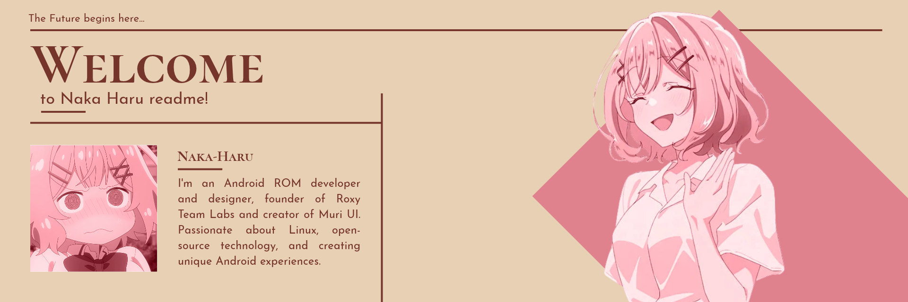

<p align="center">
  
</p>

<div align="center">


<br>


</div>

<br>

<div align="center">


*Things I'm creating and exploring.*

</div>

### 🌸 Muri UI


**Muri UI** is my personal Android ROM project, focused on customization, interface design, and creating unique Android experiences.

Currently undergoing a complete redesign and development.

### ✦ Roxy Team Labs


**Roxy Team Labs** is my development space for Android projects, software experiments, and creative ideas.

A place to learn, build, and share.

<br>

<div align="center">


*Learning something new, one step at a time.*

</div>

```text
~/workspace
│
├── android/
│   ├── custom-roms
│   ├── aosp
│   └── device-development
│
├── programming/
│   ├── python
│   └── backend-development
│
└── creative/
    ├── ui-design
    └── open-source
```

<br>

<div align="center">


*Tools and technologies I use or study.*

<br>


</div>

<br>

<div align="center">


*My little corner of GitHub.*

<br>


</div>

<br>

<div align="center">


*Find my projects and follow my journey.*

<br>

[](https://github.com/Naka-Harune)

<br><br>


<sub>Made with curiosity, creativity & a little bit of sakura. 🌸</sub>

</div>
